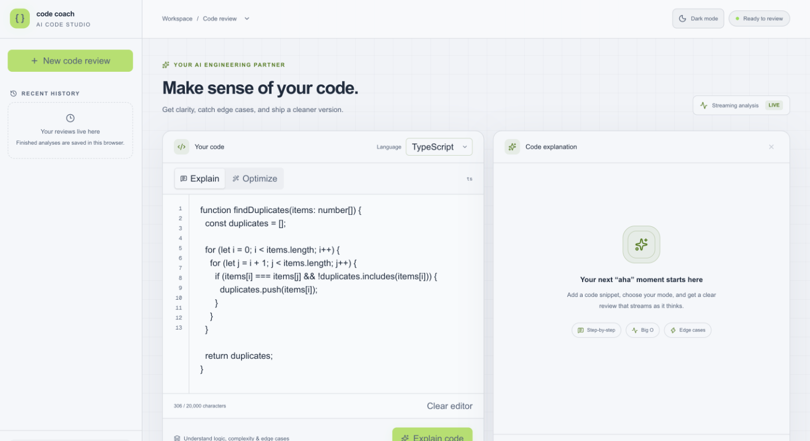

# 🚀 AI Code Coach & Explainer Dashboard

A responsive code review dashboard with dark and light themes. It explains code, analyzes Big O complexity and potential edge cases, and suggests behavior-preserving refactors. Built with the Next.js App Router, TypeScript, Tailwind CSS, and Google’s `@google/generative-ai` SDK.

🤖 **Live Demo:** Not deployed yet. Follow the local setup below to run the app.



---

## 💎 Frontend Engineering Highlights

The interface is designed around the fact that AI responses arrive incrementally and can fail before or during a stream.

* **Streaming responses via NDJSON:** The API Route Handler streams Gemini output using a Web `ReadableStream`. It sends newline-delimited JSON events, and the browser decodes and displays text as those events arrive. This is not Server-Sent Events (SSE), and response latency depends on Gemini and network conditions.
* **Local review history:** The browser stores up to 20 completed reviews in `LocalStorage`, including the submitted code and response. History stays in that browser and is not synced to an account or used to persist layout state.
* **Defensive error handling:** The API validates the request, supported language and mode, and a 20,000-character code limit. The UI displays inline messages for missing API configuration, rate limits, and failed requests.
* **Theme-aware responsive workspace:** Switch between dark and light mode; the preference is saved in `LocalStorage`. The editor and analysis layout also includes skeleton loading states, streamed response rendering, reduced-motion support, and small hover and transition effects.

---

## 🛠️ The Free-Tier-Friendly Tech Stack

| Layer | Technology | Role |
| :--- | :--- | :--- |
| **Framework** | Next.js 16 App Router | Static dashboard page and a server-side Route Handler for Gemini requests. |
| **UI** | React 19 | Client-side editor, streaming state, and LocalStorage history. |
| **Language** | TypeScript | Types for supported languages, analysis modes, history entries, and stream events. |
| **Styling** | Tailwind CSS 4 | Responsive layout and dark-first styling. |
| **AI** | `@google/generative-ai` with Gemini 3.8 Flash | Server-side code explanations and refactor suggestions. |
| **Hosting option** | Netlify | Supports the Next.js App Router and streaming Route Handlers; configure the Gemini key as a server environment variable. |

Gemini and Netlify have free-tier options, but quotas, eligibility, and hosting limits can change. This project does not guarantee that every use or deployment will remain free.

---

## 📂 Project Architecture

```text
.
├── .env.example
├── next.config.ts
├── package-lock.json
├── package.json
├── tsconfig.json
├── public/
│   └── code-coach-preview.png          # Dashboard screenshot shown above
└── src/
    ├── app/
    │   ├── api/
    │   │   └── explain/
    │   │       └── route.ts             # Validates input and streams Gemini responses
    │   ├── globals.css                  # Dark theme, layout utilities, and Markdown styles
    │   ├── layout.tsx                   # Root layout and page metadata
    │   └── page.tsx                     # App Router page entry
    ├── components/
    │   ├── code-coach-dashboard.tsx     # Editor, modes, stream UI, and history sidebar
    │   └── markdown-response.tsx        # Safe Markdown rendering for model responses
    └── lib/
        ├── history.ts                   # LocalStorage history validation and persistence
        └── types.ts                     # Language, audit, history, and stream event types
```

---

## ⚡ Quick Start & Local Setup

### 1. Prerequisites & API Key

Use Node.js 20.9 or later and npm. Create a Gemini API key in [Google AI Studio](https://aistudio.google.com/app/apikey). Free-tier access and limits depend on Google’s current terms, account, model, and region.

### 2. Install Dependencies

From the project directory, install the locked dependencies and create your local environment file:

```bash
npm install
cp .env.example .env.local
```

### 3. Configure the API Key

Add the key to `.env.local` in the project root, alongside `package.json`:

```env
GEMINI_API_KEY=
```

Replace the empty value with the key you created in Google AI Studio. Keep it private: do not add a `NEXT_PUBLIC_` prefix, and do not commit `.env.local`. The checked-in `.env.example` intentionally contains no key.

### 4. Run the Development Server

```bash
npm run dev
```

Open [http://localhost:3000](http://localhost:3000). The dashboard can load without an API key, but analysis requests require `GEMINI_API_KEY`.

### Deploying on Netlify

Push the repository to a Git provider, then import it from the Netlify dashboard. Netlify's Next.js adapter supports the App Router and streaming Route Handlers without additional project configuration. In **Site configuration → Environment variables**, add `GEMINI_API_KEY` with your Gemini API key, then deploy or trigger a new deploy. Keep the key server-side; never expose it in a `NEXT_PUBLIC_` variable.

See the [Netlify Next.js deployment guide](https://docs.netlify.com/build/frameworks/framework-setup-guides/nextjs/overview/) for current setup details and platform limits.

---

## 🧠 Core Engineering Design Patterns

### Client-Side Stream Processing

The route emits one JSON event per line. The client preserves partial lines between network chunks, parses each complete event, and appends text as it arrives. The implementation also handles an incomplete final line and surfaces stream error events.
Before reading the stream, the client POSTs `{ code, language, mode }` and checks the HTTP response and response body.

```typescript
const reader = result.body.getReader();
const decoder = new TextDecoder();
let buffered = "";
let completeResponse = "";

const consumeLine = (line: string) => {
  if (!line.trim()) return;
  const event = JSON.parse(line) as StreamEvent;
  if (event.type === "error") throw new Error(event.message);
  if (event.type === "text") {
    completeResponse += event.text;
    setResponse(completeResponse);
  }
};

try {
  while (true) {
    const { done, value } = await reader.read();
    if (done) break;
    buffered += decoder.decode(value, { stream: true });
    const lines = buffered.split("\n");
    buffered = lines.pop() ?? "";
    lines.forEach(consumeLine);
  }
  buffered += decoder.decode();
  if (buffered.trim()) consumeLine(buffered);
} finally {
  reader.releaseLock();
}
```

`StreamEvent` is defined in `src/lib/types.ts`. The API request also includes the selected `language` and `mode`; the Gemini key is never sent to the browser. Submitted code is sent to Google Gemini for analysis, so do not include secrets or sensitive source code.

---

## 📜 License

This repository does not currently include a license file. Add a license before redistributing or accepting contributions under specific terms.

---

💡 **Built as a frontend engineering portfolio project.**
